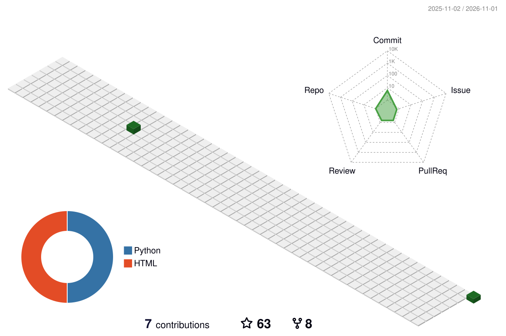

  

  <strong>Data &amp; Full-Stack Engineer</strong> · Denver, CO 
  MS in Data Analytics (AI/ML) · Python · C# / .NET · SQL · TypeScript · Azure · AWS · Docker · Kubernetes

  
  
  

## About

- I build data pipelines, APIs, and web apps, mostly in **Python** and **C# / .NET**. Over the years I've worked as a data engineer, analyst, data scientist, and software engineer.
- Lately I've been building a microservices eCommerce platform (.NET services, Angular front end, deployed with Docker Compose and Kubernetes) and writing about ASP.NET Core on my blog.
- I care about clean design, automation, and shipping products that work.
- Off the clock you'll find me listening to music or strength training.

## Featured projects

| Project | What it is | Built with |
| --- | --- | --- |
| [eCommerceMicroservices](https://github.com/sminerport/eCommerceMicroservices) | Microservices-based eCommerce platform with an Angular front end. Each service lives in its own repo and deploys with Docker Compose or Kubernetes. | Angular · TypeScript · C# / .NET · Docker · Kubernetes |
| [SequencePredictionANN](https://github.com/sminerport/SequencePredictionANN) | Neural network that predicts the next number in a sequence, with separate classes for data prep, architecture, and training. | Python · NumPy · scikit-learn |
| [IMDbSentimentClassifier](https://github.com/sminerport/IMDbSentimentClassifier) | Bidirectional LSTM with GloVe embeddings that classifies IMDb reviews as positive or negative. | Python · TensorFlow · NLP |
| [HealthcareExpertSystem](https://github.com/sminerport/HealthcareExpertSystem) | Rule-based expert system for heart failure telemonitoring, built to support patient self-care and clinical management. | Python · Pyke |
| [FollowEqualizer](https://github.com/sminerport/FollowEqualizer) | Desktop tool for managing GitHub followers and starred repos, with multithreading and real-time caching. | Python · PyQt5 · GitHub API |
| [EnhancedTextWriterCOM](https://github.com/sminerport/EnhancedTextWriterCOM) | C# COM object registered for use from VBA, demonstrating early and late binding, with a companion blog post. | C# · COM · VBA |

More projects are pinned below and listed under [repositories](https://github.com/sminerport?tab=repositories).

## Skills

| Area | Technologies |
| --- | --- |
| **Languages** | Python · C# · SQL · TypeScript / JavaScript · R · Java · C / C++ · Bash |
| **Web & APIs** | ASP.NET Core · Flask · Django · Node.js · REST · Angular · React · Vue · HTML / CSS · Bootstrap · Tailwind |
| **Data & ML** | Pandas · NumPy · scikit-learn · TensorFlow · NLP · Jupyter |
| **Databases** | PostgreSQL · SQL Server · MySQL · Oracle · SQLite · MongoDB · Redis |
| **Cloud & DevOps** | Azure · AWS · GCP · Docker · Kubernetes · GitHub Actions · Nginx · RabbitMQ |
| **Tools** | Git / GitHub · VS Code · PyCharm · IntelliJ · Postman · Jira · Linux / WSL |

## Latest blog posts

<!-- This list is refreshed hourly by .github/workflows/update-blog.yml. Edit the blog, not this block. -->
<!-- BLOG-POST-LIST:START -->
- [Setting Up Your ASP.NET Core Development Environment: A Beginner’s Guide](https://bloggie-efhpg4bbcsc0b2bz.westus2-01.azurewebsites.net/Blogs?urlHandle=setting-up-aspnet-core-development-environment)
- [Comparing ASP.NET Web Forms, ASP.NET MVC, and ASP.NET Core](https://bloggie-efhpg4bbcsc0b2bz.westus2-01.azurewebsites.net/Blogs?urlHandle=comparing-aspnet-web-forms-aspnet-mvc-aspnet-core)
- [Introduction to ASP.NET Core: A Modern, Cross-Platform Web Framework](https://bloggie-efhpg4bbcsc0b2bz.westus2-01.azurewebsites.net/Blogs?urlHandle=introduction-aspnet-core-modern-cross-platform)
<!-- BLOG-POST-LIST:END -->

Updated automatically every hour · [Subscribe via RSS](https://bloggie-efhpg4bbcsc0b2bz.westus2-01.azurewebsites.net/feed)

## Contribution activity

  <picture>
    <source media="(prefers-color-scheme: dark)" srcset="https://raw.githubusercontent.com/sminerport/sminerport/main/profile-3d-contrib/profile-night-green.svg">
    
  </picture>

## Listening to

  

